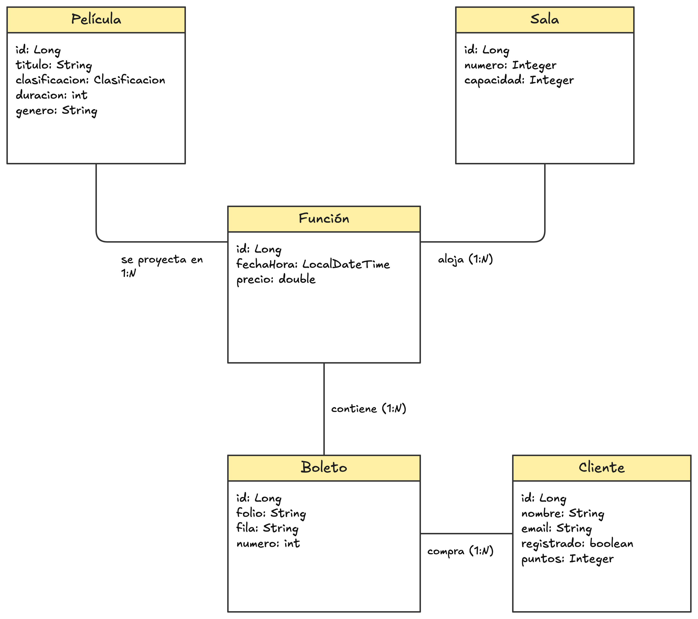

<p align="center" style="text-align: center;">
  
</p>

<h1 align="center" style="text-align: center;">Cine Las Palmas</h1>

<p align="center" style="text-align: center;">
  
  
</p>

## Caso

Cine Las Palmas tiene seis salas, cada una con un número y una capacidad. De cada película se registra el título, la clasificación (A, B, B15 o C), la duración en minutos y el género.

Una función es la proyección de una película en una sala, con fecha, hora y precio. Los clientes compran boletos para una función; cada boleto tiene un folio y un asiento identificado por fila y número. Los clientes registrados acumulan puntos con sus compras.

El cine quiere vender boletos en línea y necesita un modelo de datos claro antes de diseñar sus servicios.

## Objetivo

Elaborar el modelo de información del cine: identificar las clases y sus atributos con tipo de dato, las asociaciones y su cardinalidad, los identificadores y dos restricciones semánticas. Representar una función con su película y su sala en JSON y corregir los errores del código base proporcionado por el profesor.

## Diagrama de clases



## Nota

Para el caso se consideran seis salas de treinta lugares c/u, con las filas A, B y C y diez asientos por fila. También consideré un punto por cada diez pesos completos para los clientes registrados. La capacidad, la distribución de los asientos y la proporción de puntos se eligieron para completar el ejemplo, ya que el enunciado no fija esos valores como tal.

## Estructura del proyecto

```text
cine/
├── CineApplication.java               # Inicio de la aplicación del código base
├── controllers/
│   ├── BoletoController.java          # Compra y consulta de boletos por función
│   ├── ClienteController.java         # Registro, listado y consulta de puntos
│   ├── FuncionController.java         # Programación y consulta de funciones
│   ├── PeliculaController.java        # Registro y consulta de películas por clasificación
│   └── SalaController.java            # Registro y listado de salas
├── models/
│   ├── Boleto.java                    # Folio, asiento, función y cliente del boleto
│   ├── Clasificacion.java             # Valores permitidos: A, B, B15 y C
│   ├── Cliente.java                   # Nombre, correo, registro y puntos del cliente
│   ├── Funcion.java                   # Película, sala, horario, precio y boletos
│   ├── Pelicula.java                  # Título, clasificación, duración y género
│   └── Sala.java                      # Número y capacidad de la sala
├── repositories/
│   ├── BoletoRepository.java          # Consultas de boletos, asientos ocupados y cupo
│   ├── ClienteRepository.java         # Consultas de clientes por correo y puntos
│   ├── FuncionRepository.java         # Consultas de funciones por horario, película y sala
│   ├── PeliculaRepository.java        # Consultas de películas por género y clasificación
│   └── SalaRepository.java            # Consultas de salas por número y capacidad
└── services/
    ├── BoletoService.java             # Valida asientos y cupo, genera folios y suma puntos
    ├── ClienteService.java            # Valida el registro e inicia el saldo de puntos
    ├── FuncionService.java            # Programa funciones y evita horarios superpuestos
    └── PeliculaService.java           # Valida películas y aplica filtros de clasificación
```
